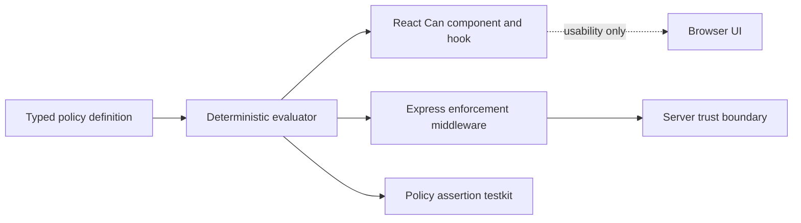

# typed-policy-kit

Type-safe authorization policies shared by React and Express without pretending that UI checks are a security boundary.

`typed-policy-kit` is a small, code-first TypeScript library for role-based access control with contextual conditions. A single policy model powers UI decisions, API enforcement, and policy-focused tests while the Node.js server remains the final authority.

```ts
type AppSchema = {
  issue: {
    resource: Issue
    actions: 'read' | 'edit' | 'close'
  }
}

const policy = definePolicy<AppSchema, User, RequestContext>({
  name: 'issue-policy',
  rules: [
    {
      id: 'authors-can-edit',
      effect: 'allow',
      roles: ['contributor'],
      resourceType: 'issue',
      actions: ['edit'],
      when: ({ subject, resource, context }) =>
        subject.id === resource.authorId && resource.tenantId === context.tenantId,
    },
    {
      id: 'archived-issues-are-immutable',
      effect: 'deny',
      resourceType: 'issue',
      actions: ['edit', 'close'],
      when: ({ resource }) => resource.status === 'archived',
    },
  ],
})
```

Invalid resources and actions fail during TypeScript compilation. Requests with no matching allow rule are denied. Matching deny rules override matching allow rules.

## Why this project exists

Authorization logic often drifts into three incompatible copies: conditionals in React, route checks in Node.js, and ad hoc test fixtures. This project keeps the decision semantics in a framework-independent core and adds narrow adapters around it.



The React adapter answers what a user interface should show. The Express adapter decides what a caller is actually allowed to do.

## Packages

| Package                                    | Purpose                                                                   |
| ------------------------------------------ | ------------------------------------------------------------------------- |
| [`typed-policy-core`](packages/core)       | Framework-independent policy schema, rules, evaluator, and decision model |
| [`typed-policy-react`](packages/react)     | Typed provider, `Can` component, and `usePolicyDecision` hook             |
| [`typed-policy-express`](packages/express) | Express 5 middleware, problem responses, and authorized resource hand-off |
| [`typed-policy-testkit`](packages/testkit) | Framework-neutral allow and deny assertions                               |

All public packages produce ESM, CommonJS, source maps, and TypeScript declarations. Version `0.1.0` is distributed as package tarballs attached to the GitHub release. npm publishing is intentionally deferred until the public API has received external feedback.

## Authorization semantics

- Default deny when no allow rule matches
- Explicit deny overrides every matching allow
- Exact resource and action names with no wildcards
- One or more roles per subject with no implicit hierarchy
- Synchronous, code-first contextual predicates
- Predicate failures throw `PolicyEvaluationError` and never grant access
- Deterministic matched rule IDs for diagnostics and tests
- Frozen policy metadata and decision values

The complete contract and threat model are documented in [Authorization model](docs/authorization-model.md).

## Team Console demo

[`apps/team-console`](apps/team-console) is a multi-tenant issue console built with React 19 and Express 5. Switch between viewer, contributor, maintainer, and admin subjects to see the same policy evaluated in both layers.

The demo proves four non-trivial cases:

1. Tenant isolation on collection and direct resource requests
2. Ownership conditions for contributor edits
3. Server-side denial of API bypass attempts
4. Explicit deny precedence for archived resources

Run it locally:

```bash
corepack enable
pnpm install --frozen-lockfile
pnpm dev
```

Open `http://127.0.0.1:5173`.

## Development

Requirements are Node.js 22.12 or newer and pnpm 11.

```bash
pnpm install --frozen-lockfile
pnpm verify
pnpm test:e2e
```

`pnpm verify` runs formatting checks, strict type-aware linting, TypeScript checks, unit and integration tests with coverage, compile-time API tests, dual-format builds, and package artifact validation with publint and Are the Types Wrong.

CI exercises Node.js 22 and 24. Release tags build and attach all four package tarballs to GitHub without publishing them to npm.

## Design boundaries

Version `0.1.0` deliberately does not include a JSON policy language, asynchronous predicates, wildcard actions, role inheritance, or a remote policy service. These boundaries keep evaluation deterministic and prevent dynamic code execution from becoming part of the public contract. The reasoning is recorded in [ADR 0001](docs/adr/0001-code-first-synchronous-policies.md).

## Project status

The API is early and follows semantic versioning. Security reports should follow [SECURITY.md](SECURITY.md). Contributions are described in [CONTRIBUTING.md](CONTRIBUTING.md).

Licensed under the [MIT License](LICENSE).
